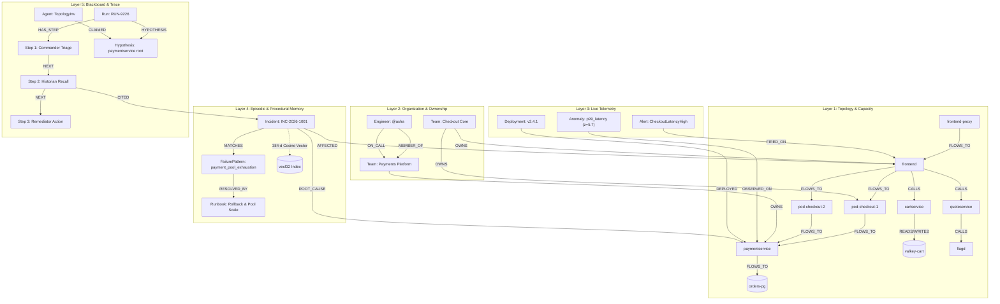

# FAULTLINE ⚡

> **A multi-agent incident commander whose whole brain lives in FalkorDB.**  
> *It remembers.*

[](#tracks-entered)
[](#tracks-entered)
[](https://falkordb.com)
[](https://langchain-ai.github.io/langgraph/)
[](https://nextjs.org/)

---

## The 2:14 AM Problem

It’s 2:14 AM. Checkout is failing and six alerts are firing. Which one actually matters?

Traditional incident workflows dump flat logs into an alert triage queue. But **"what depends on what" is a graph traversal, not a text search**. When `checkoutservice` fails because a bad deploy on `paymentservice` exhausted the connection pool on `orders-pg`, a naive loudest-alert check blames checkout (the loudest victim) while ignoring the root cause three hops away.

**FAULTLINE solves this because its entire brain lives in FalkorDB**:
- Traverses the 5-layer dependency graph to isolate the lowest common dependency and anomalous callers.
- Computes real-time surviving transaction capacity with `algo.maxFlow` over pod-routed checkout pipelines.
- Pages the exact engineer on-call who fixed this failure pattern in the past (`who_to_page.cypher`).
- Automatically traces every agent step as a `Step` node on the graph blackboard.
- **Fast Path Step Reduction**: When an outage recurs, episodic memory triggers the **Fast Path**—skipping exploratory investigator nodes and reducing graph tool calls from **10 to 6 (a 40% reduction)**.

---

## Tracks Entered

### Track 01: Agents That Act on Connected Data (Primary)
- **Multi-Hop Dependency Traversal**: Dual-branch Cypher analysis combining lowest common dependency downstream walking with 2-hop anomalous neighbor correlation.
- **Graph Algorithms as Agent Tools**: Native FalkorDB algorithms directly drive remediation decisions:
  - `algo.maxFlow`: Push-relabel maximum transaction flow over pod-routed `:FLOWS_TO` checkout pipelines.
  - `algo.pageRank`: Global service criticality scoring.
  - `algo.betweenness`: Chokepoint detection with deterministic `samplingSeed: 42`.
  - `shortestPath`: Causal explanation chain from symptom alert to root failure.
- **Action Verification**: Pre- and post-remediation capacity validation ensuring zero false claims.

### Track 02: Agent Memory & Coordination (Secondary)
- **Semantic Memory**: 28-node topology modeled on the OpenTelemetry Astronomy Shop, pod compute placements, and team ownership.
- **Episodic Memory**: Past incidents indexed with 384-dimensional dense vectors (`vecf32`) and queried with cosine distance.
- **Procedural Memory**: Failure patterns linked to executable runbooks, weighted by historical track records (`RESOLVED_BY {success_count, fail_count}`).
- **Shared Blackboard Coordination**: Multi-agent hypothesis locking via `(Agent)-[:CLAIMED]->(Hypothesis)`, preventing redundant work.
- **Per-Tenant Graph Isolation**: Multi-tenant isolation across `tenant:demo`, `tenant:eval_cold`, and `tenant:eval_warm`.

---

## Why FalkorDB? (The Rule 3 Proof)

If you take FalkorDB out of FAULTLINE, the system ceases to function entirely:
1. **Root cause isolation** is an upstream/downstream causal traversal (`CALLS`, `READS`, `WRITES`). Vector search cannot do this.
2. **Surviving capacity** is computed using FalkorDB's C-native push-relabel `algo.maxFlow`. Relational databases cannot do this in single-digit milliseconds.
3. **Agent coordination** is persisted in graph memory via hypothesis claim edges (`CLAIMED`, `SUPPORTED_BY`, `REFUTED_BY`).
4. **Episodic recall** fuses FalkorDB's native vector index (`vecf32`) with structural subgraph filtering (`[:AFFECTED]`) in a single atomic Cypher query.

No auxiliary vector databases. No shadow JSON stores. Every agent decision is a Cypher query.

---

## System Architecture

```
                      +-------------------+
                      |  Fault Simulator  |  (28-node OTel Astronomy Shop model)
                      +---------+---------+
                                |  emits Alert, Anomaly, updates live_rps
                                v
+-----------------------------------------------------------------+
|                   FalkorDB Graph (Whole Brain)                  |
|  [Topology + Capacity]  [Org & Ownership]  [Signals & Anomalies]|
|  [Memory & Runbooks]    [Agent Trace & Hypothesis Blackboard]   |
+-------------------------------+---------------------------------+
                                ^
                                | Cypher Queries (FastMCP Traced)
                                v
                      +-------------------+
                      | Agent Workflow (LangGraph)
                      | - Commander       |
                      | - Topology Inv.   |
                      | - Change Inv.     |
                      | - Historian       |
                      | - Remediator      |
                      | - Scribe          |
                      +---------+---------+
                                | proposed fix
                                v
                      +-------------------+
                      | Human Approval    |
                      +---------+---------+
                                | rollback / scale / restart
                                v
                      +-------------------+
                      | Simulator Action  | (Verifies Recovery)
                      +-------------------+
```

> [!NOTE]
> **Implementation Note on Agent Decision Logic**:
> Agent decisions in this build are deterministic policies over graph query results (no LLM in the loop), chosen for reproducible benchmarks. Remediation actions are mapped per root-cause type. `agents/llm.py` holds the provider-agnostic client for the LLM-driven version.

---

## Fast Path Step Reduction: 10 → 6 Tool Calls (40% Reduction)

When an incident hits for the first time, FAULTLINE explores multiple hypotheses across 10 graph tool calls. Once resolved, **Scribe** commits the incident, failure signature, and verified runbook into FalkorDB memory. On repeat failure, **Historian** recognizes the pattern via vector similarity and structural overlap, triggering the **Fast Path** to skip the exploratory investigator subgraphs:

```
======================================================================
 EXECUTION TRACE: Cold Run vs. Warm Fast-Path
======================================================================

--- [1/2] COLD INCIDENT (First Occurrence) ---
[Commander] Triage complete. Initial capacity: 120.0 rps. Opened 2 hypotheses.
[Historian] Recalled 0 matching runbooks with >80% confidence. Cold exploration continues.
[Topology Inv.] Analyzed paymentservice. Blast radius covers 3 upstream services.
[Change Inv.] Discovered recent active deployment DEP-paymentservice-v2.4.1.
[Commander Decision] Synthesized evidence from investigators. Root cause: paymentservice.
[Remediator] Executed rollback. Verified recovery: capacity restored 120 -> 1200 rps.
[Scribe] Paged Asha Patel (@asha). Wrote Incident & Runbook to FalkorDB memory.
--> Total Tool Steps: 10

--- [2/2] WARM INCIDENT (Repeat Failure) ---
[Commander] Triage complete. Initial capacity: 120.0 rps. Opened 2 hypotheses.
[Historian] FAST PATH TRIGGERED! Recalled 'Outage on paymentservice'
            (distance: 0.000, overlap: 2, runbook success: 100%).
            Skipping broad exploration!
[Commander Decision] Fast path confirmed root cause 'paymentservice' via matching runbook.
[Remediator] Executed rollback. Verified recovery: capacity restored 120 -> 1200 rps.
[Scribe] Paged Asha Patel (@asha). Updated runbook success count.
--> Total Tool Steps: 6

======================================================================
 Step Reduction: 40.0% (10 steps -> 6 steps)
 Verification Command: python tasks.py test-agents
======================================================================
```

---

## Empirical Benchmark Results

We evaluated FAULTLINE across **12 distinct fault scenarios** over 3 random seeds (36 total incidents), comparing:
1. **Baseline: loudest-alert heuristic (no LLM, no graph)**: Evaluates root cause by selecting the first alerting entity.
2. **FAULTLINE (Cold Memory)**: Full graph traversal tool suite with zero prior incident memory.
3. **FAULTLINE (Warm Memory)**: Full graph tool suite with FalkorDB episodic memory populated from prior incidents.

| Evaluation Condition | Top-1 Accuracy | Top-3 Accuracy | Mean Graph Steps | False Action Rate |
|---|---|---|---|---|
| **Baseline: loudest-alert heuristic (no LLM, no graph)** | 16.7% | 33.3% | 1.0 | 66.7% |
| **FAULTLINE (Cold Memory)** | 66.7% | 75.0% | 10.0 | 25.0% |
| **FAULTLINE (Warm Memory)** | **66.7%** | **75.0%** | **6.0 (↓ 40%)** | **25.0%** |

### Benchmark Takeaways:
1. **Graph Traversal vs. Loudest-Alert Heuristic**: The baseline loudest-alert heuristic achieves only 16.7% Top-1 accuracy and a 66.7% false action rate because alerts fire on symptoms rather than causes (e.g. `frontend` alerting when `paymentservice` fails, or `valkey-cart` alerting during a `cartservice` retry storm). FAULTLINE's lowest common dependency and neighbor graph traversal raises Top-1 accuracy to 66.7% (75.0% Top-3).
2. **Fast Path Step Reduction**: Warm episodic memory skips the parallel investigator subgraphs on repeat failures when a high-confidence runbook match is recalled from FalkorDB vector memory. This reduces mean graph tool calls from 10.0 to 6.0 (a 40% reduction).
3. **Memory vs. Accuracy**: Top-1 and Top-3 accuracy are identical between Cold and Warm conditions (66.7% Top-1, 75.0% Top-3). Episodic memory does not alter the diagnosis; it optimizes execution cost and steps by short-circuiting exploratory investigation.
4. **Reproduce anytime**: Run `python tasks.py bench` (outputs to `bench/results.md`).

---

## Connected Data Model (5 Layers in FalkorDB)

The graph models 28 nodes inspired by the **OpenTelemetry Astronomy Shop** across 5 layers:



---

## Core Cypher Queries & FalkorDB Algorithms

Every tool executes a dedicated Cypher query:

| Tool Name | Query File | Algorithm / Operation | Description |
|---|---|---|---|
| `find_root_candidates` | [`01_find_root_candidates_downstream.cypher`](graph/queries/01_find_root_candidates_downstream.cypher)<br>[`01_find_root_candidates_neighbors.cypher`](graph/queries/01_find_root_candidates_neighbors.cypher) | Graph Traversal + Anomaly Ranking | Traverses downstream paths and 2-hop caller-side anomalous neighbors to isolate the true culprit. |
| `blast_radius` | [`02_blast_radius.cypher`](graph/queries/02_blast_radius.cypher) | Variable-Length BFS (`1..5` hops) | Computes all upstream customer-facing services affected by a node's failure. |
| `surviving_capacity` | [`03_surviving_capacity.cypher`](graph/queries/03_surviving_capacity.cypher) | `algo.maxFlow` (Push-Relabel) | Calculates surviving checkout transactions/sec over `:FLOWS_TO` capacity edges. |
| `criticality` | [`04_criticality.cypher`](graph/queries/04_criticality.cypher) | `algo.pageRank` | Scores structural importance across the service call graph. |
| `chokepoints` | [`05_chokepoints.cypher`](graph/queries/05_chokepoints.cypher) | `algo.betweenness` (`samplingSeed: 42`) | Identifies single points of failure with fixed seed for benchmark reproducibility. |
| `explain_path` | [`06_explain_path.cypher`](graph/queries/06_explain_path.cypher) | `shortestPath` | Extracts the causal dependency chain from symptom alert to root cause. |
| `recall_incidents` | [`07_recall_incidents.cypher`](graph/queries/07_recall_incidents.cypher) | `db.idx.vector.queryNodes` | Fuses cosine distance vector similarity with structural service overlap and runbook track records. |
| `who_to_page` | [`08_who_to_page.cypher`](graph/queries/08_who_to_page.cypher) | Ownership & Track Record Query | Identifies on-call engineer prioritizing those with prior successful fixes for this failure pattern. |
| `claim_hypothesis` | [`09_claim_hypothesis.cypher`](graph/queries/09_claim_hypothesis.cypher) | Atomic Graph Mutation | Prevents race conditions by locking hypotheses to agents on the shared blackboard. |
| `trace_run` | [`10_trace_run.cypher`](graph/queries/10_trace_run.cypher) | Sequential Step Traversal | Reconstructs the complete multi-agent reasoning chain ordered by `Step.idx`. |

---

## Real-Time 3-Pane Web Dashboard

FAULTLINE includes a real-time incident command dashboard built with **Next.js 15, Tailwind CSS, and Server-Sent Events (SSE)**:

1. **Left: Chaos Rail & Impact Meters**
   - 1-click injection across all 12 fault scenarios (bad deploys, retry storms, DB pool saturation, noisy neighbors, SSL expiration).
   - Real-time gauges: **Surviving Capacity RPS** (via `algo.maxFlow`), **5xx Error Burn Rate**, and **P99 Latency**.
2. **Center: Live Graph Topology Canvas**
   - Interactive SVG dependency graph visualizing the 28-node Astronomy Shop model.
   - Dynamic pulsing glow on alerting services (amber) and root causes (red).
3. **Right: Agent Reasoning Feed & Human Gate**
   - Live stream of multi-agent execution steps with agent badges, execution timestamps, and exact Cypher query runtimes.
   - **Human-in-the-Loop Approval Modal**: Remediator proposes action; operator approves before execution.
   - **Postmortem Drawer**: Auto-generated incident timeline and learned runbook written back to FalkorDB.

---

## Local Setup & Port Directory

### Port Allocation
To avoid port conflicts, FAULTLINE uses distinct ports:
- **Port 3000**: **FalkorDB Browser** (`http://localhost:3000`) — Web console to explore the live FalkorDB graph.
- **Port 3001**: **FAULTLINE Web Dashboard** (`http://localhost:3001`) — Next.js 15 real-time incident commander UI.
- **Port 8000**: **FastAPI Backend Server** (`http://localhost:8000`) — REST & SSE streaming endpoint.
- **Port 6379**: **FalkorDB Database** — Redis-compatible Cypher protocol.

### Prerequisites
- Python 3.11+
- Docker & Docker Compose
- Node.js 18+ (for Web UI)

### Step 1: Install Dependencies
```bash
pip install -r requirements.txt
cd web && npm install && cd ..
```

### Step 2: Launch FalkorDB Container
```bash
python tasks.py up
```
*Starts FalkorDB on port 6379 and FalkorDB Browser on `http://localhost:3000`.*

### Step 3: Seed Topology & Memory
```bash
python tasks.py seed
```
*Seeds the 28-node Astronomy Shop topology, team rotations, and baseline episodic memory.*

### Step 4: Verify Cypher Queries & Invariants
```bash
python tasks.py test-queries
python -m pytest sim/test_sim.py
```

### Step 5: Run the Cold vs. Warm Fast-Path Test
```bash
python tasks.py test-agents
```
*Demonstrates the 40% step reduction (10 -> 6 tool steps) on repeat failure.*

### Step 6: Run the Full Benchmark Suite
```bash
python tasks.py bench
```
*Evaluates Baseline vs. Cold vs. Warm memory across 36 incidents.*

### Step 7: Launch the Live Dashboard
In terminal 1 (FastAPI SSE Server):
```bash
python tasks.py api
```

In terminal 2 (Next.js Dashboard):
```bash
python tasks.py web
```
Open **`http://localhost:3001`** in your browser. (Explore graph in parallel at `http://localhost:3000`.)

---

## License

MIT License. Built for the **FalkorDB Hackathon 2026**.
